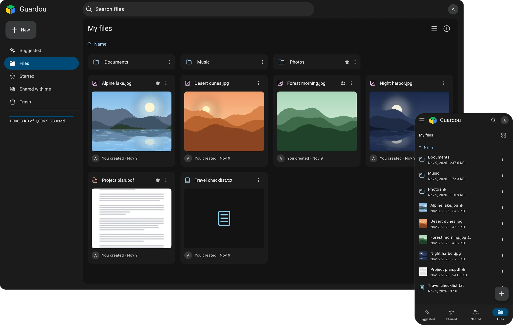

<h1 align="center">Guardou!</h1>
 

  

 

> [!NOTE]
> **This is a fork.** `albrtbc/Guardou` is a fork of [GuardouApp/Guardou](https://github.com/GuardouApp/Guardou) with security hardening for self-hosted use.

## About

Guardou is a self-hosted file storage solution. Designed to be a simple alternative for users who want to store and organize some files through a simple web ui.

**Core Features:**
- Multiple users
- SSO Support
- URL sharing

## Getting Started

The installation guide can be found [here](https://guardou.app/docs/overview/quick-start).

## Tech Stack

| Tool    | Version        |
|---------|----------------|
| .NET    | 10             |
| C#      | 14             |
| Flutter | 3.47.8         |

## Disclaimer

Guardou is in early-stage development breaking changes are expected. 
If you decide to use it, follow the [3-2-1](https://www.backblaze.com/blog/the-3-2-1-backup-strategy/) backup strategy.

## AI Usage

This fork is developed with extensive AI assistance. Every change still has to meet the same bar before it is merged: passing tests and a review. The rules are in [CONTRIBUTING.md](CONTRIBUTING.md).
